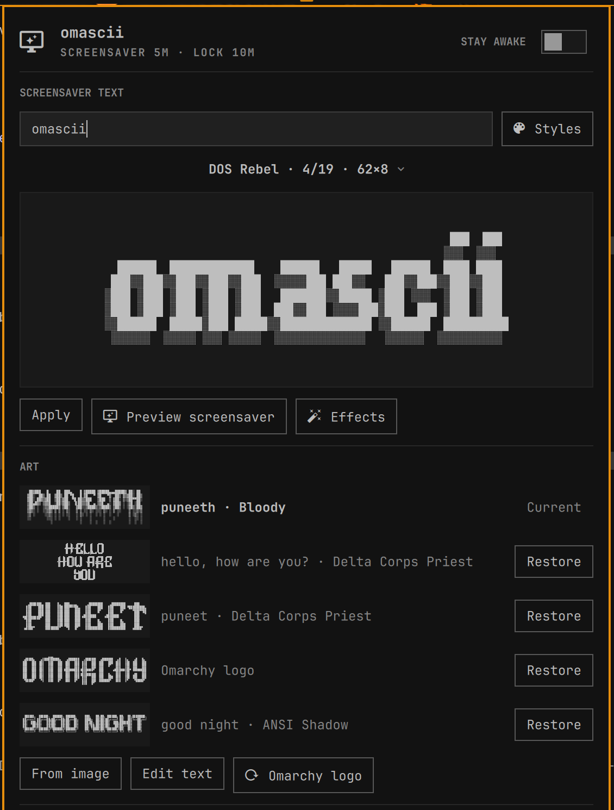

# omascii

Turn your text into ASCII art for the [Omarchy](https://omarchy.org) screensaver, straight from the top bar.



Click the bar icon, type something, and browse 19 figlet styles with a live preview. Press **Apply** and the Omarchy
screensaver shows your art the next time it runs. Choose which screensaver effects play, and change the screensaver
and idle settings Omarchy offers, all from the same panel.

## Features

- **Text → ASCII art.** 19 bundled styles:
  - Unicode block fonts, which suit the screensaver best: Delta Corps Priest, ANSI Shadow, Bloody, DOS Rebel, ANSI Regular, Electronic, Elite, Calvin S and Kompakt Block.
  - Classic figlet fonts: 3D ASCII, Larry 3D, Star Wars, Big Money, Graffiti, Big, Doom, Slant, Standard and Small.
  - The **Styles** button shows your text in every style at once, so you can pick one at a glance.
  - The art is sized to your screens: long text wraps, and overlong words split across lines. See [Fitting the screen](#fitting-the-screen).
  - Some fonts have no digits or punctuation. A style that would drop characters from your text is marked **DROPS**, and one that can't fit is marked **TOO BIG**. Both are listed after the styles that draw your text in full.
- **Effects.** Switch individual screensaver effects on or off, with a ▶ preview for each. With one left on it loops; with several, each cycle picks one at random. See [Effects](#effects).
- **Recent arts.** The last arts you used, with one-click restore. Art you set another way (from an image, or by editing the file) is saved before omascii replaces it, so nothing is lost.
- **Screensaver and idle controls.** Screensaver on/off, Stay Awake, screensaver and lock delays, Lock now, Preview, Set from image, Edit text, and Restore the Omarchy logo.
- **Bar icon.** Dims when the screensaver is off and turns your accent colour while staying awake. Right-click it to preview the screensaver.
- **Menu entry.** Style › Screensaver › **Generate from Text** opens the panel. Turn it off with the panel's *In Omarchy menu* switch.

## Install

Requires:

- **Omarchy 4**, which has the Quickshell shell.
- **figlet**: the panel offers an **Install figlet** button if it's missing.
- **A supported terminal:** Alacritty, Foot, Ghostty or Kitty, the same ones Omarchy's screensaver supports.

```bash
omarchy plugin add https://github.com/Puneethkethanapalli/omascii.git --enable --yes
omarchy pkg add figlet
```

The icon appears on the right of the bar. To get the latest version later:

```bash
omarchy plugin update io.github.puneethkethanapalli.omascii
```

## Use

| In the panel | Does |
|---|---|
| Type | Renders every style (after a short pause) |
| ↑ / ↓, ◀ / ▶ | Previous / next style |
| **Styles** button, Alt+↓, or click the style name | Open the style picker: your text in every style, with its size and any warnings. Works before typing too, to choose a style up front |
| Enter | Apply |
| Ctrl+Enter | Apply and preview the screensaver |
| **Effects** button, or Alt+E | Choose which effects the screensaver plays |
| Esc | Close |

To open the panel from a keybinding, add this to `~/.config/hypr/bindings.lua`:

```lua
o.bind("SUPER + SHIFT + A", "omascii", "omarchy-shell shell toggle io.github.puneethkethanapalli.omascii")
```

### Command line

Everything the panel does goes through `bin/omascii` in the plugin folder, which also works on its own:

```bash
omascii=~/.config/omarchy/plugins/io.github.puneethkethanapalli.omascii/bin/omascii
$omascii render --text "hello" --style ansi-shadow --raw   # print the art
$omascii apply --text "hello" --style ansi-shadow          # set it as the screensaver
$omascii history                                           # recent arts (JSON)
$omascii restore default                                   # back to the Omarchy logo
$omascii idle set --screensaver 300 --lock 600             # delays in seconds
$omascii --help
```

Every command except `render --raw` and `--help` prints one line of JSON. On failure that's `{"ok":false,"error":…}`
with a non-zero exit.

## Effects

Omarchy's screensaver plays a random effect each cycle, chosen from all 37 of
[ttfx](https://github.com/omacom-io/ttfx)'s effects. With every effect switched on (the default), omascii leaves that
exactly as it is.

Once you switch some off, omascii runs the screensaver itself:

- It turns on Omarchy's "screensaver off" switch so the stock screensaver stays quiet, and starts its own at the same
  idle delay, in the same full-screen window type (`org.omarchy.screensaver`).
- Omarchy's idle service still owns the lock timer and watches that window, so locking, dismissing with any key, Stay
  Awake and idle inhibitors (such as video playback) behave as before.
- Effect changes apply from the next cycle; there's nothing to restart.
- Turn every effect back on (**All on**) and Omarchy's own screensaver takes over again, keeping your on/off choice.
  The same happens when the plugin is disabled or removed, even without `uninstall.sh`.

While omascii runs the screensaver, use the panel's switch to turn it on or off. The Omarchy menu's screensaver toggle
can turn it back on, but not off.

In the Effects sheet: ↑/↓ move, Space toggles, **P** previews, **A** turns everything on, Esc closes.

From the command line:

```bash
$omascii effects                      # list with on/off
$omascii effects set blackhole off    # switch one off
$omascii effects only matrix          # loop a single effect
$omascii effects all                  # back to Omarchy's random effects
$omascii preview --effect rain        # play one effect once
```

## Fitting the screen

Omarchy draws the screensaver in an 18pt terminal on every monitor, and that size can't be changed. Instead, omascii
fits the art to it:

- **The size limit comes from your monitors.** omascii reads them with `hyprctl` and uses the smallest, since every
  screen shows the same art. For example, a 2880×1800 laptop panel at 2× scale fits 99×28 characters.
- **Long text wraps** at spaces, and a single word that's too wide is split across lines. When rows are tight, the
  blank row between lines is dropped.
- **Styles that fit are listed first.** If the style you picked stops fitting as you type, the panel shows the first
  one that does and says why, then goes back to yours when the text gets shorter again.

A style is only marked **TOO BIG** when it can't fit at all, usually a tall font like Delta Corps Priest with several
lines of text. Pressing Apply twice uses it anyway.

To use a fixed limit instead (say, for a smaller external monitor you sometimes plug in), set it on the bar entry in
`~/.config/omarchy/shell.json`:

```json
{ "id": "io.github.puneethkethanapalli.omascii", "maxCols": 80, "maxRows": 26 }
```

## What it changes

omascii only touches what Omarchy already lets you change:

- `~/.config/omarchy/branding/screensaver.txt`, the screensaver art. Each write is atomic, and the previous art is
  kept in your history.
- The `idle` block of `~/.config/omarchy/shell.json`, which holds the screensaver and lock delays. Other settings and
  their order are left alone.
- Omarchy's own toggles for the screensaver and Stay Awake.
- A "Generate from Text" row in `~/.config/omarchy/extensions/omarchy-menu.jsonc`, between marker comments.

Its own data lives in `~/.local/state/omascii`, which holds history and your original art, and in
`~/.config/omascii/effects.json`, which holds your effect choice.

## Troubleshooting

- **The panel says figlet is missing.** Click **Install figlet**, or run `omarchy pkg add figlet`. The panel unlocks
  by itself once figlet is installed.
- **Effects don't change anything.** omascii runs the screensaver only in Alacritty, Foot, Ghostty or Kitty, the same
  terminals Omarchy supports. Check yours with `xdg-terminal-exec --print-id`.
- **The screensaver stopped after uninstalling.** It shouldn't, because omascii hands the screensaver back when it's
  removed. If it does happen, `omarchy toggle screensaver` turns it back on.

## Uninstall

```bash
omarchy plugin remove io.github.puneethkethanapalli.omascii
```

This hands the screensaver back to Omarchy. The Style › Screensaver row hides itself once omascii is gone; to delete it
as well, switch off *In Omarchy menu* in the panel before removing the plugin.

From a checkout, `./uninstall.sh` does all of this and offers to restore the art you had before omascii. `--purge` also
deletes the history in `~/.local/state/omascii` and your effect choice.

## Development

```bash
git clone https://github.com/Puneethkethanapalli/omascii.git && cd omascii
./install.sh             # copy this checkout into ~/.config/omarchy/plugins, install figlet, enable on the bar
omarchy restart shell    # load QML changes
test/run                 # backend, Model.js, font coverage, manifest, qmllint and plugin-id checks
```

`install.sh` copies rather than symlinks, because the shell's reload watcher doesn't follow symlinks. Re-run it after
every edit. Changes to `bin/omascii` take effect straight away. The shell caches plugin QML, so after changing a `.qml`
file run `omarchy restart shell`.

Layout:

- `bin/omascii`: bash + jq backend: rendering, history, idle settings, effects and the screensaver runner. Every file
  write is atomic (temp file + rename next to the target).
- `Service.qml`: one per shell. Holds state, watches Omarchy's toggle, indicator and config files, queues backend
  calls, and starts omascii's screensaver when effects are customised.
- `BarWidget.qml`, `Panel.qml`: the bar icon and the panel, built from Omarchy's `qs.Ui` kit.
- `components/`: `StylePicker` and `EffectsPicker` (the two pop-up lists), `StyleBrowser`, `AsciiPreview` and
  `CommandJob`.
- `Model.js`: pure helpers, tested with `node --test`.
- `fonts/`: the bundled FIGlet fonts and `styles.json`, the style catalogue. See [fonts/FONTS.md](fonts/FONTS.md) for
  credits and for adding a style.
- `test/`: `run` runs every check. `backend.test.sh` runs against a throwaway home folder with mock Omarchy commands,
  and `font-coverage` keeps each style's list of missing characters current.

## License

[MIT](LICENSE). The bundled fonts keep their own terms; see [fonts/FONTS.md](fonts/FONTS.md).
